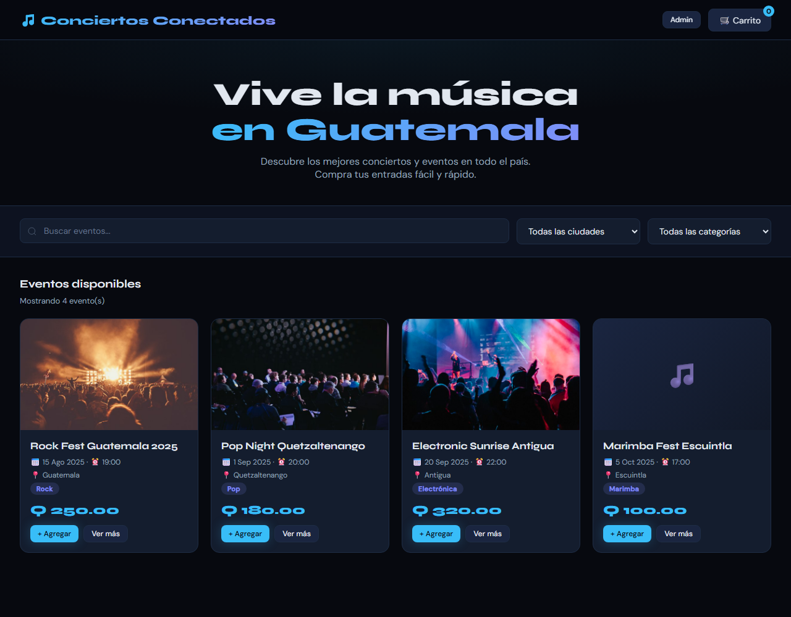

# Conciertos Conectados

Plataforma web de venta de entradas para conciertos en Guatemala, construida como SPA con JavaScript puro (sin frameworks ni backend), con vista de cliente y panel de administración.


**Demo:** https://toto05-a.github.io/conciertos-spa/



## Funcionalidades

**Cliente**
- Catálogo de eventos con búsqueda por texto y filtros por ciudad y categoría.
- Detalle de cada evento (fecha, hora, ciudad, precio en quetzales).
- Carrito de compras: agregar, cambiar cantidades y quitar entradas.
- Checkout con datos del comprador y boleta de compra generada.

**Administrador** (rol protegido por inicio de sesión)
- Dashboard con estadísticas generales.
- CRUD de categorías y de eventos (con imagen, código, precio y fecha).
- Historial de ventas con detalle de cada boleta.
- Módulo de ciudades (alta, edición y eliminación).

## Stack

- HTML5 y CSS3 (diseño oscuro, responsive, tipografías Syne y DM Sans).
- JavaScript puro (ES6+): enrutado entre páginas, estado y renderizado manual.
- Web Components personalizados (`<event-card-wc>`).
- `localStorage` como base de datos del navegador, con datos de ejemplo (*seed*) en el primer arranque.

## Estructura

```
├── index.html        # Páginas: login, admin, clientes y modales
├── app.js            # Lógica: datos, auth, admin, carrito y checkout
├── components.js     # Web Components
├── styles.css        # Estilos
├── js/ views/ components/ assets/   # Versión modular por módulos ES (en evolución)
└── ProyectoConcierto/               # Versión anterior del proyecto
```

## Cómo ejecutarlo

No requiere instalación. Abre `index.html` en el navegador o sirve la carpeta:

```bash
python -m http.server 8000
# abre http://localhost:8000
```

Para entrar al panel: botón **Admin** y credenciales de demostración `admin@mail.com` / `123456` (no es autenticación real: es un proyecto académico sin servidor).

## Autor

**Antonio Cruz** (Toto) · [@TOTO05-a](https://github.com/TOTO05-a) · Ingeniería de Sistemas, Guatemala.
